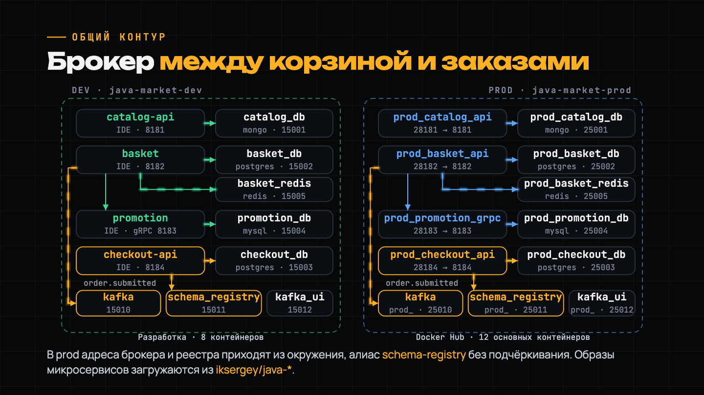

# Java Marketplace — демонстрационный запуск

Академический маркетплейс из четырёх микросервисов: каталог товаров, корзина, оформление заказов и промоакции. Готовые образы загружаются из Docker Hub — для запуска нужен только работающий Docker с Docker Compose.


## Запуск

Перейди из корня репозитория в папку демонстрационного запуска:

```bash
cd demo
```

Затем выполни команду для своей ОС. Все команды в этой инструкции выполняются из папки `demo`.

**Linux**

```bash
bash compose/start-linux.sh
```

**macOS, включая Mac на ARM**

```bash
bash compose/start-macos.command
```

**Windows — PowerShell или cmd, Docker Desktop в режиме Linux-контейнеров**

```powershell
.\compose\start-windows.cmd
```

Скрипт скачает образы и запустит окружение в фоне. На Mac ARM Java-сервисы работают через эмуляцию `amd64`, остальные контейнеры используют архитектуру хоста. Ни JDK, ни Gradle устанавливать не нужно.

<details>
<summary>После запуска в терминале будет примерно такой результат</summary>

```text
[+] up 68/68
 ✔ Image iksergey/java-catalog-api:latest      Pulled
 ✔ Image iksergey/java-basket-api:latest       Pulled
 ✔ Image iksergey/java-checkout-api:latest     Pulled
 ✔ Image iksergey/java-promotion-grpc:latest   Pulled
 ✔ Image mongo:8.2                             Pulled
 ✔ Image postgres:18.1                         Pulled
 ✔ Image mysql:9.7                             Pulled
 ✔ Image redis:8.8                             Pulled
 ✔ Image apache/kafka:4.3.1                    Pulled
 ✔ Image confluentinc/cp-schema-registry:8.3.2 Pulled
 ✔ Image ghcr.io/kafbat/kafka-ui:v1.5.0        Pulled
 ✔ Image prom/prometheus:v3.15.0               Pulled
 ✔ Image grafana/grafana:13.2.2                Pulled
 ✔ Image portainer/portainer-ce:2.45.1         Pulled
 ✔ Network java-market-prod_default            Created
 ✔ Container prod_catalog_db                   Healthy
 ✔ Container prod_basket_db                    Healthy
 ✔ Container prod_checkout_db                  Healthy
 ✔ Container prod_promotion_db                 Healthy
 ✔ Container prod_basket_redis                 Healthy
 ✔ Container prod_kafka                        Healthy
 ✔ Container prod_schema_registry              Healthy
 ✔ Container prod_catalog_api                  Started
 ✔ Container prod_basket_api                   Started
 ✔ Container prod_checkout_api                 Started
 ✔ Container prod_promotion_grpc               Started
 ✔ Container prod_kafka_ui                     Started
 ✔ Container prod_prometheus                   Started
 ✔ Container prod_grafana                      Started
 ✔ Container prod_portainer                    Started
```

Количество шагов и время зависят от кеша Docker. После `Started` Java-приложениям нужно немного времени на инициализацию.

</details>

## Схема взаимодействия



Демонстрационный запуск соответствует правой части схемы. На ней показаны 12 основных контейнеров; дополнительно запускаются Prometheus, Grafana и Portainer. Два сценария k6 включаются отдельно.

Корзина получает скидки у Promotion по gRPC и публикует `order.submitted` в Kafka. Checkout читает событие и сохраняет заказ. Avro-контракт хранится в Schema Registry. Каталог использует MongoDB, корзина — PostgreSQL и Redis, заказы — PostgreSQL, промоакции — MySQL.

## Что открыть после запуска

- **Catalog — Swagger** — http://localhost:28181/swagger-ui/index.html.
- **Basket — Swagger** — http://localhost:28182/swagger-ui/index.html.
- **Checkout — Swagger** — http://localhost:28184/swagger-ui/index.html.
- **Promotion — gRPC** — `localhost:28183`, без TLS.
- **Catalog — health** — http://localhost:28181/actuator/health.
- **Promotion — health** — http://localhost:28193/actuator/health.
- **Kafka UI** — http://localhost:25012.
- **Schema Registry** — http://localhost:25011/subjects.
- **Prometheus** — http://localhost:25030.
- **Grafana** — http://localhost:25031.
- **Portainer** — https://localhost:25040.

Grafana открывается без авторизации. Portainer: логин `admin`, пароль `marketplace-admin`; используется локальный HTTPS-сертификат. У Basket и Checkout endpoint `/actuator/health` отсутствует — проверяй их через Swagger и API.

## API по сервисам

JSON-примеры лежат в [`examples`](examples). Все команды ниже выполняются из папки `demo`. В Windows PowerShell для HTTP-команд используй `curl.exe` вместо `curl`.

### 1. Catalog — каталог товаров

Базовый адрес: `http://localhost:28181`. [Swagger](http://localhost:28181/swagger-ui/index.html) · [OpenAPI JSON](docs/catalog.openapi.json).

- **GET** `/api/v1/brands` — Список брендов.
- **GET** `/api/v1/categories` — Список категорий.
- **GET** `/api/v1/items` — Все товары.
- **GET** `/api/v1/items/{id}` — Товар по ID.
- **GET** `/api/v2/items` — Товары с пагинацией, поиском, фильтрами и сортировкой.
- **POST** `/api/v1/items` — Создать товар; тело: [`catalog-create.json`](examples/catalog-create.json).
- **PUT** `/api/v1/items` — Обновить товар, ID передаётся в теле: [`catalog-update.json`](examples/catalog-update.json).
- **DELETE** `/api/v1/items/{id}` — Удалить товар.

У `/api/v2/items` доступны `pageIndex` (с нуля), `pageSize`, `brandId`, `categoryId`, `search` и `sort`, например `price,asc` или `price,desc`.

```bash
curl http://localhost:28181/api/v1/brands
curl http://localhost:28181/api/v1/categories
curl "http://localhost:28181/api/v2/items?pageIndex=0&pageSize=5&sort=price,asc"
curl -X POST -H "Content-Type: application/json" --data-binary "@examples/catalog-create.json" http://localhost:28181/api/v1/items
curl -X PUT -H "Content-Type: application/json" --data-binary "@examples/catalog-update.json" http://localhost:28181/api/v1/items
```

Перед POST подставь в JSON реальные `brandId` и `categoryId` из справочников. POST вернёт `{"id":"…"}`. Для PUT добавь этот ID в поле `id`.

### 2. Basket — корзина покупателя

Базовый адрес: `http://localhost:28182`. [Swagger](http://localhost:28182/swagger-ui/index.html) · [OpenAPI JSON](docs/basket.openapi.json).

- **POST** `/api/v1/cart` — Сохранить корзину, добавить или заменить позиции: [`basket-save.json`](examples/basket-save.json).
- **GET** `/api/v1/cart/{accountName}` — Получить корзину и общую стоимость; отсутствующая корзина вернёт 404.
- **DELETE** `/api/v1/cart/{accountName}` — Удалить корзину.
- **POST** `/api/v1/cart/checkout` — Оформить корзину: [`basket-checkout.json`](examples/basket-checkout.json).

```bash
curl -X POST -H "Content-Type: application/json" --data-binary "@examples/basket-save.json" http://localhost:28182/api/v1/cart
curl http://localhost:28182/api/v1/cart/readme_demo
curl -X POST -H "Content-Type: application/json" --data-binary "@examples/basket-checkout.json" http://localhost:28182/api/v1/cart/checkout
```

`basket-save.json` создаёт корзину аккаунта `readme_demo` с двумя единицами демонстрационного товара. При сохранении Basket обращается к Promotion: скидка — сумма, вычитаемая из `unitPrice`, а не процент. Если промоакции нет, скидка равна нулю.

Оформление возвращает **202 Accepted**, `orderId` и `correlationId`. Заказ появляется в Checkout асинхронно через Kafka. Повторная отправка запроса оформления создаёт новый заказ; корзина после оформления сохраняется.

### 3. Checkout — оформление и хранение заказов

Базовый адрес: `http://localhost:28184`. [Swagger](http://localhost:28184/swagger-ui/index.html) · [OpenAPI JSON](docs/checkout.openapi.json).

- **GET** `/api/v1/orders/{accountName}` — Все заказы аккаунта.
- **POST** `/api/v1/orders` — Создать заказ напрямую: [`order-create.json`](examples/order-create.json).
- **DELETE** `/api/v1/orders/{id}` — Удалить заказ по UUID; успешный ответ — 204.

После оформления корзины:

```bash
curl http://localhost:28184/api/v1/orders/readme_demo
```

Создать заказ напрямую:

```bash
curl -X POST -H "Content-Type: application/json" --data-binary "@examples/order-create.json" http://localhost:28184/api/v1/orders
```

POST возвращает **201 Created** и ID заказа. Допустимы `BANK_TRANSFER` и `CREDIT_CARD`; при `CREDIT_CARD` требуется объект `cardDetails` с полями `cardName`, `cardNumber`, `expiration`, `cvv`. Пример использует `BANK_TRANSFER`.

### 4. Promotion — промоакции по gRPC

Адрес: `localhost:28183`, **plaintext**, сервис **`PromoService`**. Контракт: [`promo.proto`](examples/promo.proto). В Postman создай gRPC-запрос, укажи адрес и импортируй этот файл либо используй server reflection.

- `PromoService/GetPromo` — поля запроса: `catalogItemId`; пример: [`promo-get.json`](examples/promo-get.json).
- `PromoService/CreatePromo` — поля запроса: `catalogItemId`, `title`, `value`; пример: [`promo-create.json`](examples/promo-create.json).
- `PromoService/UpdatePromo` — поля запроса: `id`, `title`, `value`; пример: [`promo-update.json`](examples/promo-update.json).
- `PromoService/DeletePromo` — поля запроса: `catalogItemId`; пример: [`promo-delete.json`](examples/promo-delete.json).

Через установленный [`grpcurl`](https://github.com/fullstorydev/grpcurl), в Linux/macOS:

```bash
grpcurl -plaintext localhost:28183 list
grpcurl -plaintext localhost:28183 describe PromoService
grpcurl -plaintext -d @ localhost:28183 PromoService/GetPromo < examples/promo-get.json
grpcurl -plaintext -d @ localhost:28183 PromoService/CreatePromo < examples/promo-create.json
grpcurl -plaintext -d @ localhost:28183 PromoService/UpdatePromo < examples/promo-update.json
grpcurl -plaintext -d @ localhost:28183 PromoService/DeletePromo < examples/promo-delete.json
```

В Windows PowerShell тело можно передать так:

```powershell
Get-Content -Raw examples/promo-get.json | grpcurl -plaintext -d '@' localhost:28183 PromoService/GetPromo
```

`CreatePromo` возвращает `id`: подставь его вместо `<promoId>` в примере обновления. При отсутствии промоакции `GetPromo` возвращает модель с нулевой скидкой; поля с нулевыми значениями могут быть опущены в JSON-ответе gRPC.

### Метрики и инфраструктура

- Catalog: `GET http://localhost:28181/actuator/prometheus`.
- Promotion: `GET http://localhost:28193/actuator/prometheus`.
- Kafka: `localhost:25010`; топик заказов — `order.submitted`, схема — `order.submitted-value`.
- MongoDB: `localhost:25001`, база/логин/пароль — `catalog`, `authSource=admin`.
- PostgreSQL Basket: `localhost:25002`, база/логин/пароль — `basket`.
- PostgreSQL Checkout: `localhost:25003`, база/логин/пароль — `checkout`.
- MySQL: `localhost:25004`, база/логин/пароль — `promotion`.
- Redis: `localhost:25005`, без пароля.
- Schema Registry: `localhost:25011`, например `GET /subjects` и `GET /subjects/order.submitted-value/versions` после первого события.

## Библиотеки и версии

Версии библиотек проверены по JAR-файлам внутри опубликованных образов. Версии инструментов сборки взяты из настроек приложений. Снимок: **31 октября 2026**, образы `iksergey/java-*:latest`; при обновлении образов состав может измениться.

- **Java / Eclipse Temurin** — 25 / `25.0.4.1_1`. Все сервисы.
- **Spring Boot, Web MVC, JDBC, JPA, Redis, Kafka, Actuator starters** — 4.1.1. По назначению сервиса.
- **Spring Framework** — 7.0.9. Все сервисы.
- **Spring Data MongoDB / MongoDB Java Driver** — 5.1.1 / 5.8.1. Catalog.
- **PostgreSQL JDBC** — 42.7.13. Basket, Checkout.
- **MySQL Connector/J** — 9.7.0. Promotion.
- **Hibernate ORM / Hibernate Validator** — 7.4.5.Final / 9.1.3.Final. JPA / валидация.
- **Flyway** — 12.4.0. Checkout.
- **Lettuce** — 7.5.2.RELEASE. Redis-клиент Basket.
- **Spring Kafka / Kafka Java Client** — 4.1.1 / 4.2.1. Basket, Checkout.
- **Confluent Kafka Avro Serializer** — 8.3.2. Basket, Checkout.
- **Apache Avro / avro-compiler** — 1.12.2. Контракт событий.
- **gRPC Java / Spring gRPC** — 1.83.1 / 1.1.1. Basket → Promotion / сервер Promotion.
- **Protocol Buffers / protoc** — 4.35.1. gRPC-контракты.
- **springdoc OpenAPI** — 3.1.1. Catalog, Basket, Checkout.
- **Jackson** — 3.1.5; совместимость с Jackson 2 — 2.22.1. JSON.
- **Micrometer / Prometheus registry** — 1.17.1. Catalog, Promotion.
- **MapStruct / mapstruct-processor** — 1.6.3. Catalog, Checkout, Promotion.
- **Lombok** — 1.18.46. Сборка всех сервисов.
- **Lombok MapStruct binding** — 0.2.0. Сборка мапперов.
- **Gradle** — 9.8.0. Сборка приложений.
- **Gradle Protobuf plugin / protoc-gen-grpc-java** — 0.10.0 / 1.83.1. Генерация gRPC-кода.
- **Foojay toolchain resolver** — 1.0.0. Выбор JDK при сборке.
- **common-kernel, common-messaging, common-metrics** — 0.0.1-SNAPSHOT. Внутренние библиотеки приложений.

Контейнерная инфраструктура:

- [MongoDB 8.2](https://hub.docker.com/_/mongo) — `mongo:8.2`.
- [PostgreSQL 18.1](https://hub.docker.com/_/postgres) — `postgres:18.1`.
- [MySQL 9.7](https://hub.docker.com/_/mysql) — `mysql:9.7`.
- [Redis 8.8](https://hub.docker.com/_/redis) — `redis:8.8`.
- [Apache Kafka 4.3.1](https://hub.docker.com/r/apache/kafka) — `apache/kafka:4.3.1`.
- [Confluent Schema Registry 8.3.2](https://hub.docker.com/r/confluentinc/cp-schema-registry) — `confluentinc/cp-schema-registry:8.3.2`.
- [Kafbat Kafka UI 1.5.0](https://hub.docker.com/r/kafbat/kafka-ui) — `ghcr.io/kafbat/kafka-ui:v1.5.0`.
- [Prometheus 3.15.0](https://hub.docker.com/r/prom/prometheus) — `prom/prometheus:v3.15.0`.
- [Grafana 13.2.2](https://hub.docker.com/r/grafana/grafana) — `grafana/grafana:13.2.2`.
- [Portainer CE 2.45.1](https://hub.docker.com/r/portainer/portainer-ce) — `portainer/portainer-ce:2.45.1`.
- [k6 2.3.0](https://hub.docker.com/r/grafana/k6) — `grafana/k6:2.3.0`.

<details>
<summary>Полный список библиотек внутри образов — 201 уникальный JAR, включая транзитивные зависимости</summary>

Catalog — 87 JAR, Basket — 152, Checkout — 125, Promotion — 101. Для каждой библиотеки указаны версия и сервисы, в образы которых она входит. Библиотеки с одинаковым названием и разными версиями приведены отдельно. Машиночитаемый список: [`dependencies.json`](docs/dependencies.json).

- `angus-activation` — **2.0.3**; Basket, Checkout.
- `animal-sniffer-annotations` — **1.27**; Basket, Promotion.
- `annotations` — **4.1.1.4**; Basket, Promotion.
- `antlr4-runtime` — **4.13.2**; Basket, Checkout.
- `aspectjweaver` — **1.9.25.1**; Basket, Checkout.
- `avro` — **1.12.2**; Basket, Checkout.
- `bson` — **5.8.1**; Catalog.
- `bson-record-codec` — **5.8.1**; Catalog.
- `byte-buddy` — **1.18.11**; Basket, Checkout.
- `catalog-application` — **0.0.1-SNAPSHOT**; Catalog.
- `catalog-domain` — **0.0.1-SNAPSHOT**; Catalog.
- `catalog-infrastructure` — **0.0.1-SNAPSHOT**; Catalog.
- `checker-qual` — **3.55.1**; Basket, Checkout.
- `checkout-application` — **0.0.1-SNAPSHOT**; Checkout.
- `checkout-domain` — **0.0.1-SNAPSHOT**; Checkout.
- `checkout-infrastructure` — **0.0.1-SNAPSHOT**; Checkout.
- `classmate` — **1.7.3**; Catalog, Basket, Checkout, Promotion.
- `common-kernel` — **0.0.1-SNAPSHOT**; Catalog, Basket, Checkout, Promotion.
- `common-messaging` — **0.0.1-SNAPSHOT**; Basket, Checkout.
- `common-metrics` — **0.0.1-SNAPSHOT**; Catalog, Promotion.
- `common-utils` — **8.3.2**; Basket, Checkout.
- `commons-codec` — **1.21.0**; Basket, Checkout.
- `commons-compress` — **1.28.0**; Basket, Checkout.
- `commons-io` — **2.20.0**; Basket, Checkout.
- `commons-lang3` — **3.20.0**; Catalog, Basket, Checkout.
- `commons-logging` — **1.3.6**; Catalog, Basket, Checkout, Promotion.
- `error_prone_annotations` — **2.18.0**; Checkout.
- `error_prone_annotations` — **2.50.0**; Basket, Promotion.
- `failureaccess` — **1.0.1**; Checkout.
- `failureaccess` — **1.0.3**; Basket, Promotion.
- `flyway-core` — **12.4.0**; Checkout.
- `flyway-database-postgresql` — **12.4.0**; Checkout.
- `grpc-api` — **1.83.1**; Basket, Promotion.
- `grpc-context` — **1.83.1**; Basket, Promotion.
- `grpc-core` — **1.83.1**; Basket, Promotion.
- `grpc-netty` — **1.83.1**; Promotion.
- `grpc-netty-shaded` — **1.83.1**; Basket.
- `grpc-protobuf` — **1.83.1**; Basket, Promotion.
- `grpc-protobuf-lite` — **1.83.1**; Basket, Promotion.
- `grpc-services` — **1.83.1**; Promotion.
- `grpc-stub` — **1.83.1**; Basket, Promotion.
- `grpc-util` — **1.83.1**; Basket, Promotion.
- `gson` — **2.14.0**; Basket, Promotion.
- `guava` — **32.0.1-jre**; Checkout.
- `guava` — **33.6.0-jre**; Basket, Promotion.
- `HdrHistogram` — **2.2.2**; Catalog, Promotion.
- `hibernate-core` — **7.4.5.Final**; Basket, Checkout.
- `hibernate-models` — **1.1.1**; Basket, Checkout.
- `hibernate-validator` — **9.1.3.Final**; Catalog, Basket, Checkout, Promotion.
- `HikariCP` — **7.0.2**; Basket, Checkout, Promotion.
- `httpclient5` — **5.6.4**; Basket, Checkout.
- `httpcore5` — **5.4.3**; Basket, Checkout.
- `httpcore5-h2` — **5.4.3**; Basket, Checkout.
- `istack-commons-runtime` — **4.1.2**; Basket, Checkout.
- `j2objc-annotations` — **2.8**; Checkout.
- `j2objc-annotations` — **3.1**; Basket, Promotion.
- `jackson-annotations` — **2.21**; Promotion.
- `jackson-annotations` — **2.22**; Catalog, Basket, Checkout.
- `jackson-core` — **2.22.1**; Catalog, Basket, Checkout.
- `jackson-core` — **3.1.5**; Catalog, Basket, Checkout, Promotion.
- `jackson-databind` — **2.22.1**; Catalog, Basket, Checkout.
- `jackson-databind` — **3.1.5**; Catalog, Basket, Checkout, Promotion.
- `jackson-dataformat-csv` — **2.22.1**; Basket, Checkout.
- `jackson-dataformat-yaml` — **2.22.1**; Catalog, Basket, Checkout.
- `jackson-datatype-jdk8` — **2.22.1**; Basket, Checkout.
- `jackson-datatype-jsr310` — **2.22.1**; Catalog, Basket, Checkout.
- `jakarta.activation-api` — **2.1.4**; Catalog, Basket, Checkout.
- `jakarta.annotation-api` — **3.0.0**; Catalog, Basket, Checkout, Promotion.
- `jakarta.inject-api` — **2.0.1**; Basket, Checkout.
- `jakarta.persistence-api` — **3.2.0**; Basket, Checkout.
- `jakarta.transaction-api` — **2.0.1**; Basket, Checkout.
- `jakarta.validation-api` — **3.1.1**; Catalog, Basket, Checkout, Promotion.
- `jakarta.xml.bind-api` — **4.0.5**; Catalog, Basket, Checkout.
- `jaxb-core` — **4.0.9**; Basket, Checkout.
- `jaxb-runtime` — **4.0.9**; Basket, Checkout.
- `jboss-logging` — **3.6.3.Final**; Catalog, Basket, Checkout, Promotion.
- `jspecify` — **1.0.1**; Catalog, Basket, Checkout, Promotion.
- `jsr305` — **3.0.2**; Basket, Checkout, Promotion.
- `jul-to-slf4j` — **2.0.18**; Catalog, Basket, Checkout, Promotion.
- `kafka-avro-serializer` — **8.3.2**; Basket, Checkout.
- `kafka-avro-types` — **8.3.2**; Basket, Checkout.
- `kafka-clients` — **4.2.1**; Basket, Checkout.
- `kafka-schema-registry-client` — **8.3.2**; Basket, Checkout.
- `kafka-schema-serializer` — **8.3.2**; Basket, Checkout.
- `kafka-schema-types` — **8.3.2**; Basket, Checkout.
- `lettuce-core` — **7.5.2.RELEASE**; Basket.
- `listenablefuture` — **9999.0-empty-to-avoid-conflict-with-guava**; Basket, Checkout, Promotion.
- `log4j-api` — **2.25.5**; Catalog, Basket, Checkout, Promotion.
- `log4j-to-slf4j` — **2.25.5**; Catalog, Basket, Checkout, Promotion.
- `logback-classic` — **1.5.38**; Catalog, Basket, Checkout, Promotion.
- `logback-core` — **1.5.38**; Catalog, Basket, Checkout, Promotion.
- `logredactor` — **1.0.18**; Basket, Checkout.
- `logredactor-metrics` — **1.0.18**; Basket, Checkout.
- `lz4-java` — **1.10.1**; Basket, Checkout.
- `mapstruct` — **1.6.3**; Catalog, Checkout, Promotion.
- `micrometer-commons` — **1.17.1**; Catalog, Basket, Checkout, Promotion.
- `micrometer-core` — **1.17.1**; Catalog, Promotion.
- `micrometer-jakarta9` — **1.17.1**; Catalog, Promotion.
- `micrometer-observation` — **1.17.1**; Catalog, Basket, Checkout, Promotion.
- `micrometer-registry-prometheus` — **1.17.1**; Catalog, Promotion.
- `minimal-json` — **0.9.5**; Basket, Checkout.
- `mongodb-driver-core` — **5.8.1**; Catalog.
- `mongodb-driver-sync` — **5.8.1**; Catalog.
- `mysql-connector-j` — **9.7.0**; Promotion.
- `netty-buffer` — **4.2.17.Final**; Basket, Promotion.
- `netty-codec-base` — **4.2.17.Final**; Basket, Promotion.
- `netty-codec-compression` — **4.2.17.Final**; Promotion.
- `netty-codec-dns` — **4.2.17.Final**; Basket.
- `netty-codec-http` — **4.2.17.Final**; Promotion.
- `netty-codec-http2` — **4.2.17.Final**; Promotion.
- `netty-codec-socks` — **4.2.17.Final**; Promotion.
- `netty-common` — **4.2.17.Final**; Basket, Promotion.
- `netty-handler` — **4.2.17.Final**; Basket, Promotion.
- `netty-handler-proxy` — **4.2.17.Final**; Promotion.
- `netty-resolver` — **4.2.17.Final**; Basket, Promotion.
- `netty-resolver-dns` — **4.2.17.Final**; Basket.
- `netty-transport` — **4.2.17.Final**; Basket, Promotion.
- `netty-transport-native-unix-common` — **4.2.17.Final**; Basket, Promotion.
- `perfmark-api` — **0.27.0**; Basket, Promotion.
- `postgresql` — **42.7.13**; Basket, Checkout.
- `prometheus-metrics-config` — **1.7.0**; Catalog, Promotion.
- `prometheus-metrics-core` — **1.7.0**; Catalog, Promotion.
- `prometheus-metrics-exposition-formats` — **1.7.0**; Catalog, Promotion.
- `prometheus-metrics-exposition-textformats` — **1.7.0**; Catalog, Promotion.
- `prometheus-metrics-model` — **1.7.0**; Catalog, Promotion.
- `prometheus-metrics-tracer-common` — **1.7.0**; Catalog, Promotion.
- `proto-google-common-protos` — **2.64.1**; Basket, Promotion.
- `protobuf-java` — **4.35.1**; Basket, Promotion.
- `protobuf-java-util` — **4.35.1**; Promotion.
- `re2j` — **1.6**; Basket, Checkout.
- `reactive-streams` — **1.0.4**; Basket.
- `reactor-core` — **3.8.7**; Basket.
- `redis-authx-core` — **0.1.1-beta2**; Basket.
- `slf4j-api` — **2.0.18**; Catalog, Basket, Checkout, Promotion.
- `snakeyaml` — **2.6**; Catalog, Basket, Checkout, Promotion.
- `snappy-java` — **1.1.10.7**; Basket, Checkout.
- `spring-aop` — **7.0.9**; Catalog, Basket, Checkout, Promotion.
- `spring-aspects` — **7.0.9**; Basket, Checkout.
- `spring-beans` — **7.0.9**; Catalog, Basket, Checkout, Promotion.
- `spring-boot` — **4.1.1**; Catalog, Basket, Checkout, Promotion.
- `spring-boot-actuator` — **4.1.1**; Catalog, Promotion.
- `spring-boot-actuator-autoconfigure` — **4.1.1**; Catalog, Promotion.
- `spring-boot-autoconfigure` — **4.1.1**; Catalog, Basket, Checkout, Promotion.
- `spring-boot-cache` — **4.1.1**; Basket.
- `spring-boot-data-commons` — **4.1.1**; Catalog, Basket, Checkout.
- `spring-boot-data-jpa` — **4.1.1**; Basket, Checkout.
- `spring-boot-data-mongodb` — **4.1.1**; Catalog.
- `spring-boot-data-redis` — **4.1.1**; Basket.
- `spring-boot-flyway` — **4.1.1**; Checkout.
- `spring-boot-grpc-server` — **4.1.1**; Promotion.
- `spring-boot-health` — **4.1.1**; Catalog, Promotion.
- `spring-boot-hibernate` — **4.1.1**; Basket, Checkout.
- `spring-boot-http-converter` — **4.1.1**; Catalog, Basket, Checkout, Promotion.
- `spring-boot-jackson` — **4.1.1**; Catalog, Basket, Checkout, Promotion.
- `spring-boot-jarmode-tools` — **4.1.1**; Catalog, Basket, Checkout, Promotion.
- `spring-boot-jdbc` — **4.1.1**; Basket, Checkout, Promotion.
- `spring-boot-jpa` — **4.1.1**; Basket, Checkout.
- `spring-boot-kafka` — **4.1.1**; Basket, Checkout.
- `spring-boot-micrometer-metrics` — **4.1.1**; Catalog, Promotion.
- `spring-boot-micrometer-observation` — **4.1.1**; Catalog, Promotion.
- `spring-boot-mongodb` — **4.1.1**; Catalog.
- `spring-boot-netty` — **4.1.1**; Basket.
- `spring-boot-persistence` — **4.1.1**; Catalog, Basket, Checkout, Promotion.
- `spring-boot-servlet` — **4.1.1**; Catalog, Basket, Checkout, Promotion.
- `spring-boot-sql` — **4.1.1**; Basket, Checkout, Promotion.
- `spring-boot-tomcat` — **4.1.1**; Catalog, Basket, Checkout, Promotion.
- `spring-boot-transaction` — **4.1.1**; Catalog, Basket, Checkout, Promotion.
- `spring-boot-validation` — **4.1.1**; Catalog, Basket, Checkout, Promotion.
- `spring-boot-web-server` — **4.1.1**; Catalog, Basket, Checkout, Promotion.
- `spring-boot-webmvc` — **4.1.1**; Catalog, Basket, Checkout, Promotion.
- `spring-context` — **7.0.9**; Catalog, Basket, Checkout, Promotion.
- `spring-context-support` — **7.0.9**; Basket.
- `spring-core` — **7.0.9**; Catalog, Basket, Checkout, Promotion.
- `spring-data-commons` — **4.1.1**; Catalog, Basket, Checkout.
- `spring-data-jpa` — **4.1.1**; Basket, Checkout.
- `spring-data-keyvalue` — **4.1.1**; Basket.
- `spring-data-mongodb` — **5.1.1**; Catalog.
- `spring-data-redis` — **4.1.1**; Basket.
- `spring-expression` — **7.0.9**; Catalog, Basket, Checkout, Promotion.
- `spring-grpc-core` — **1.1.1**; Promotion.
- `spring-jdbc` — **7.0.9**; Basket, Checkout, Promotion.
- `spring-kafka` — **4.1.1**; Basket, Checkout.
- `spring-messaging` — **7.0.9**; Basket, Checkout.
- `spring-orm` — **7.0.9**; Basket, Checkout.
- `spring-oxm` — **7.0.9**; Basket.
- `spring-tx` — **7.0.9**; Catalog, Basket, Checkout, Promotion.
- `spring-web` — **7.0.9**; Catalog, Basket, Checkout, Promotion.
- `spring-webmvc` — **7.0.9**; Catalog, Basket, Checkout, Promotion.
- `springdoc-openapi-starter-common` — **3.1.1**; Catalog, Basket, Checkout.
- `springdoc-openapi-starter-webmvc-api` — **3.1.1**; Catalog, Basket, Checkout.
- `springdoc-openapi-starter-webmvc-ui` — **3.1.1**; Catalog, Basket, Checkout.
- `swagger-annotations-jakarta` — **2.2.55**; Catalog, Basket, Checkout.
- `swagger-core-jakarta` — **2.2.55**; Catalog, Basket, Checkout.
- `swagger-models-jakarta` — **2.2.55**; Catalog, Basket, Checkout.
- `swagger-ui` — **5.32.14**; Catalog, Basket, Checkout.
- `tomcat-embed-core` — **11.0.24**; Catalog, Basket, Checkout, Promotion.
- `tomcat-embed-el` — **11.0.24**; Catalog, Basket, Checkout, Promotion.
- `tomcat-embed-websocket` — **11.0.24**; Catalog, Basket, Checkout, Promotion.
- `txw2` — **4.0.9**; Basket, Checkout.
- `webjars-locator-lite` — **1.1.4**; Catalog, Basket, Checkout.
- `zstd-jni` — **1.5.6-10**; Basket, Checkout.

</details>

## Остановка и обновление

Из папки `demo`:

```bash
docker compose -f compose/compose.yaml ps
docker compose -f compose/compose.yaml logs -f basket_api
docker compose -f compose/compose.yaml down
```

Данные сохраняются в Docker volumes. Для обновления образов повторно выполни команду запуска своей ОС. Для выбора версии скопируй `compose/.env.example` в `compose/.env` и укажи `IMAGE_TAG=branch-main` или `IMAGE_TAG=sha-<полный SHA коммита>`.

Нагрузочные сценарии запускаются отдельно:

```bash
docker compose -f compose/compose.yaml --profile load run --rm k6_catalog
docker compose -f compose/compose.yaml --profile load run --rm k6_cart
```
